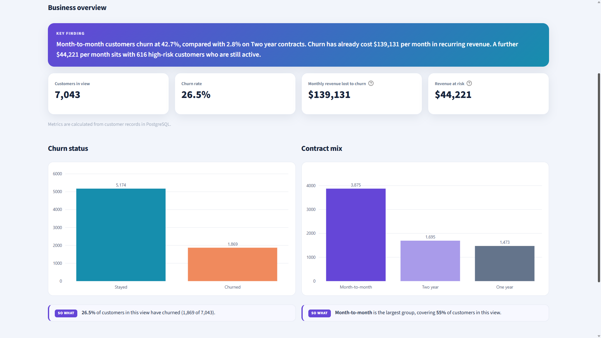
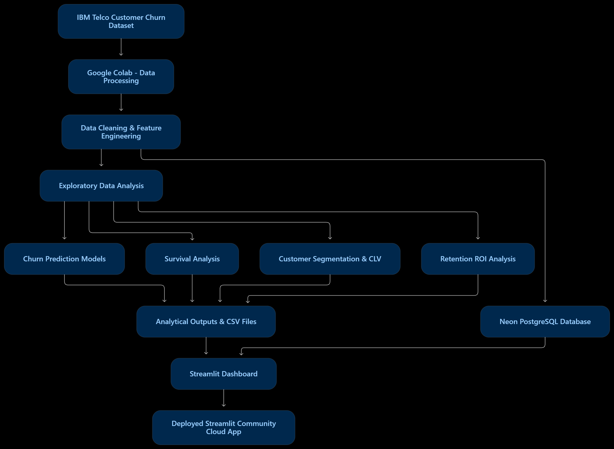
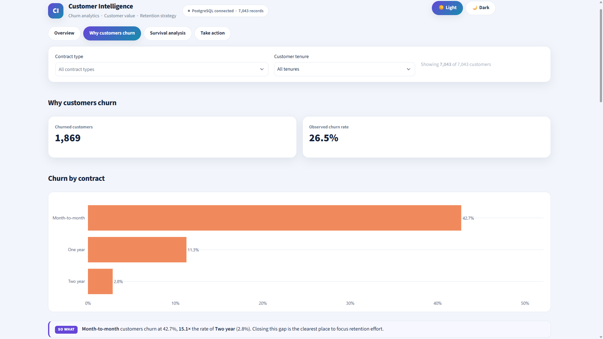
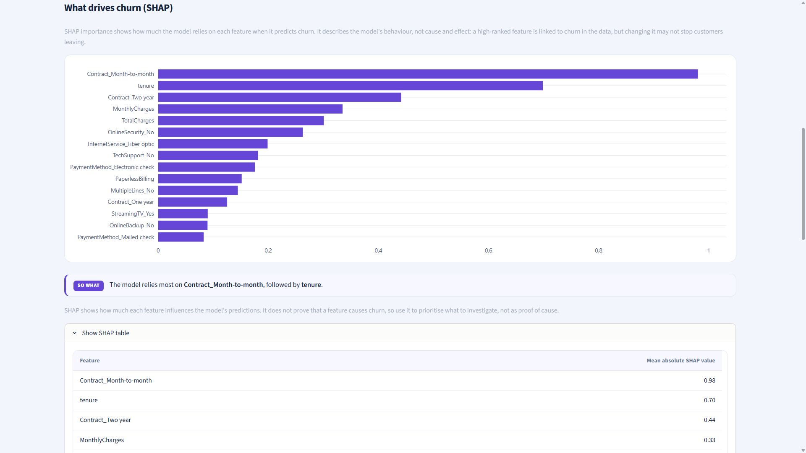
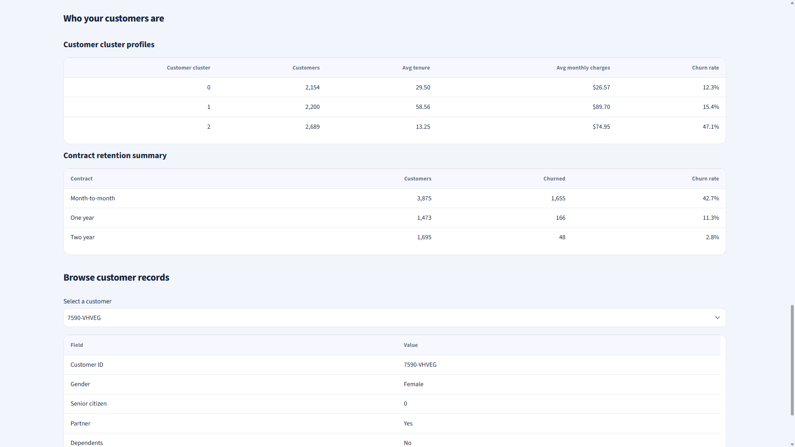
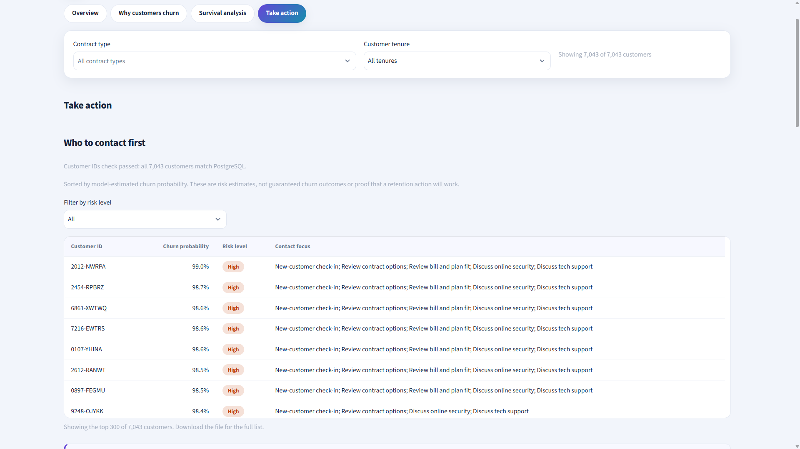
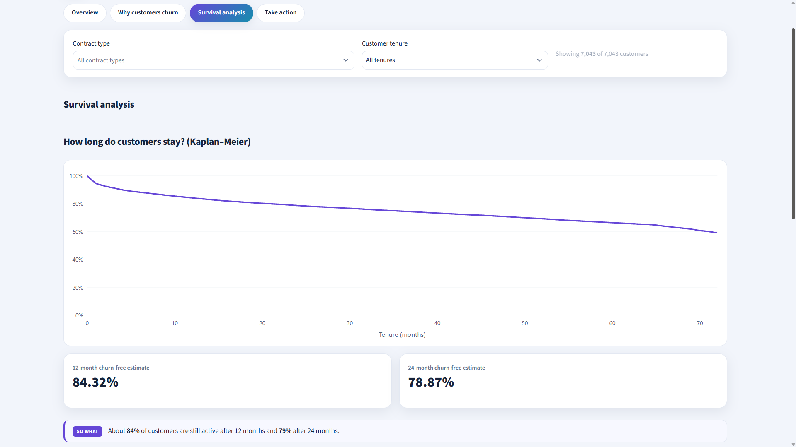
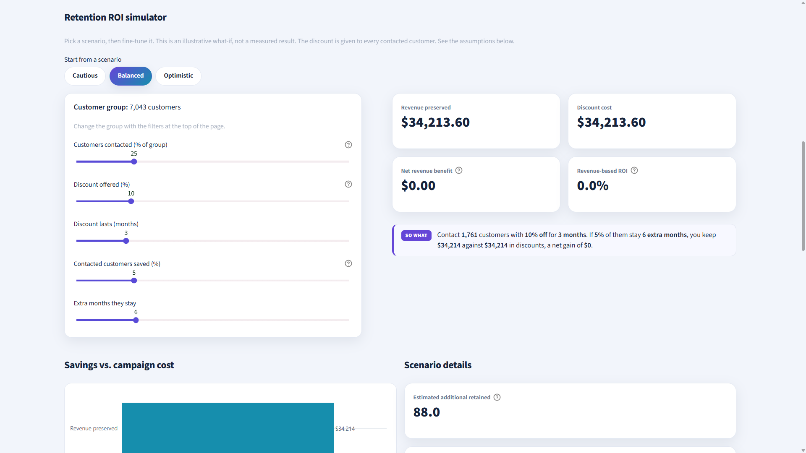

# Customer Lifetime Value & Churn Intelligence System

**DS-01 Internship Project | Nexvia Technologies**

An end-to-end customer analytics project built on the IBM Telco Customer Churn dataset to understand customer behaviour, predict churn, estimate customer lifetime value and explore retention strategies.

**Live Dashboard:** [Customer Intelligence – Streamlit](https://ds-01-customer-intelligence-project.streamlit.app/)
**GitHub:** [DS-01 Customer Intelligence](https://github.com/dinesh15-hub/DS-01-Customer-Intelligence)



## About the Project

Customer churn is a major challenge for subscription-based businesses. Understanding why customers leave, and identifying those at risk, helps a business improve retention and protect recurring revenue.

The goal of this project was to build a customer intelligence platform that combines data analysis, machine learning, survival analysis and business insights in one interactive dashboard.

The project uses **7,043 customer records** from the IBM Telco Customer Churn dataset. The workflow covers data cleaning, exploratory analysis, churn prediction, customer segmentation, CLV estimation and retention ROI analysis.

## System Architecture

1. **Data Source:** IBM Telco Customer Churn dataset (7,043 customer records).
2. **Data Processing:** Python, Pandas and NumPy for cleaning, preprocessing and feature engineering.
3. **Analytics & Modelling:** Scikit-learn and LightGBM for churn prediction, SHAP for model explainability and Lifelines for survival analysis.
4. **Database:** Customer records are stored in a Neon PostgreSQL database.
5. **Dashboard:** Streamlit connects to PostgreSQL and uses the generated analytical outputs to display customer insights, churn analysis, retention actions and ROI scenarios.
6. **Deployment:** Streamlit Community Cloud.



## Dashboard Features

The Streamlit dashboard has a top navigation bar (no sidebar), shared filters, and Light and Dark themes. It has four pages:

### 1. Overview
- Total customers, churn rate, monthly revenue and revenue at risk.
- Customer distribution and contract mix.

### 2. Why customers churn
- Churn patterns across contracts and services.
- Churn prediction with Logistic Regression and LightGBM, with model evaluation.
- SHAP feature importance (shows what influences the model, not what causes churn).
- Customer segmentation with cluster profiles.

### 3. Survival analysis
- Kaplan–Meier survival curves.
- Cox Proportional Hazards model with a proportional-hazards check.

### 4. Take action
- Customer-level churn risk list with risk levels and suggested contact focus.
- Retention ROI simulator with adjustable scenarios, revenue-based ROI and a visible disclaimer.

## Dashboard Screenshots

### Contract Churn Analysis


### SHAP Feature Importance


### Customer Cluster Profiles and Records


### Customer Churn Risk


### Kaplan–Meier Survival Analysis


### Retention ROI Simulator


## Dataset

**Source:** IBM Telco Customer Churn dataset

- Customer records: 7,043
- Original columns: 22
- Target variable: `Churn`

The dataset includes customer demographics, tenure, subscribed services, contract details, payment methods and billing information. Data cleaning and feature engineering were performed before analysis and model development.

## Technologies Used

- **Python** – main programming language
- **Pandas & NumPy** – data cleaning and manipulation
- **Scikit-learn** – machine learning and preprocessing
- **LightGBM** – churn classification
- **SHAP** – model explainability
- **Lifelines** – survival analysis
- **PostgreSQL & Neon** – customer data storage
- **Streamlit** – dashboard development
- **Plotly** – interactive visualisations

## Key Analysis

- Exploratory Data Analysis (EDA)
- Data cleaning and feature engineering
- Logistic Regression and LightGBM churn models, with evaluation and comparison
- SHAP-based feature importance
- Customer clustering and segmentation
- Customer lifetime value estimation
- Kaplan–Meier survival analysis
- Cox Proportional Hazards modelling
- Retention ROI scenario analysis

## Limitations

- **Uplift modelling not implemented.** It was part of the original requirements, but the IBM Telco dataset has no customer treatment assignments or retention offer-response data, so the real impact of a campaign cannot be measured reliably.
- **ROI is a scenario estimate, not a forecast.** It is revenue-based (not profit) and depends on assumptions such as campaign cost, success rate and customer eligibility.
- **SHAP is not causal.** It shows which features influence the model, not why customers leave.

## Running the Project Locally

**1. Clone the repository**

```bash
git clone https://github.com/dinesh15-hub/DS-01-Customer-Intelligence.git
cd DS-01-Customer-Intelligence
```

**2. Create a virtual environment (recommended)**

```bash
python -m venv venv
venv\Scripts\activate        # Windows
# source venv/bin/activate   # macOS / Linux
```

**3. Install dependencies**

```bash
pip install -r requirements.txt
```

**4. Configure PostgreSQL credentials**

Create `.streamlit/secrets.toml` and add your own database credentials:

```toml
[postgres]
host = "YOUR_HOST"
port = 5432
user = "YOUR_USERNAME"
password = "YOUR_PASSWORD"
database = "YOUR_DATABASE"
sslmode = "require"
```

Keep your credentials private. Never upload `secrets.toml` to GitHub.

**5. Run the application**

```bash
streamlit run app.py
```

The application opens at `http://localhost:8501`.

## Individual Reflection

**What I built.** I built an end-to-end customer analytics system on the IBM Telco dataset. It predicts churn with Logistic Regression and LightGBM, explains the predictions with SHAP, estimates how long customers stay with Kaplan-Meier and Cox models, and simulates the return on a retention campaign. Everything is presented in an interactive Streamlit dashboard.

**What I learned.**
- A good churn model is only useful if it leads to an action. Moving from "who will churn" to "who should we contact, and is it worth it" taught me more than tuning the model did.
- SHAP shows which features influence the model, not what causes churn. I added a note on the dashboard so the results are not read as causes.
- Survival analysis answers a different question from classification: not "will they leave?" but "when?". I also learned to check the Cox model's proportional hazards assumption instead of trusting it blindly.
- The ROI results depend heavily on assumptions such as campaign cost, success rate and customer value. I labelled the output as revenue-based ROI, not profit, and kept the assumptions and disclaimer visible.

**Challenges.** Keeping the dashboard correct when filters were applied was harder than I expected. Narrow filters can leave too few customers for survival analysis or the Cox model, so I tested every page with filters enabled and handled the empty cases. I also had to make sure customer IDs in the risk list match the source data.

**What I would improve.** Add calibrated probabilities, test the retention assumptions against real campaign data, and compare more models, with cost-sensitive thresholds for who to target.

---

## Acknowledgement

Developed as part of the **DS-01 Internship Project at Nexvia Technologies**.
Dataset: IBM Telco Customer Churn.

## Author

**Dinesh Chandra Reddy** · [GitHub Profile](https://github.com/dinesh15-hub)
